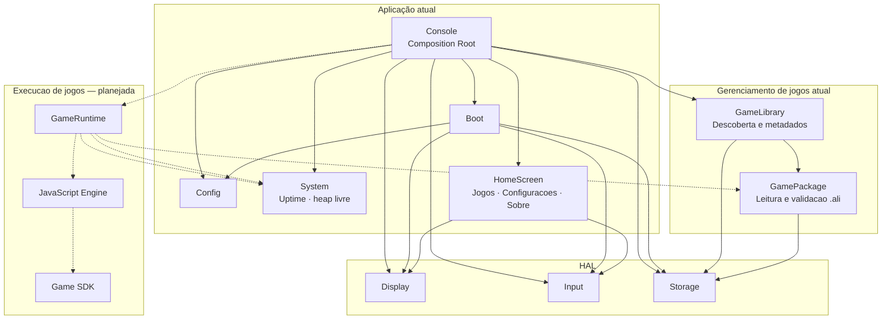
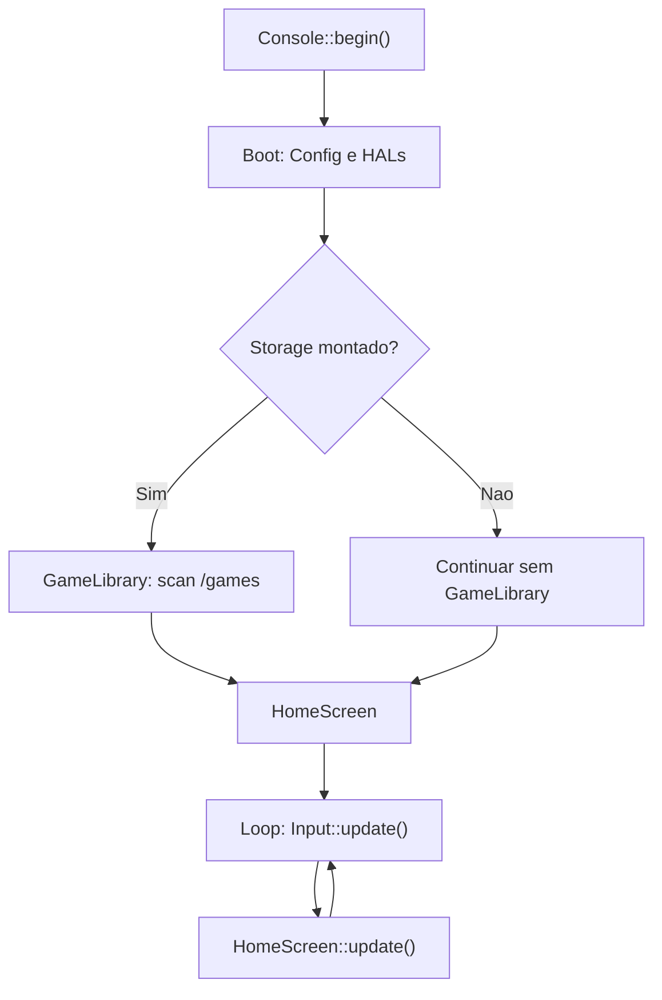
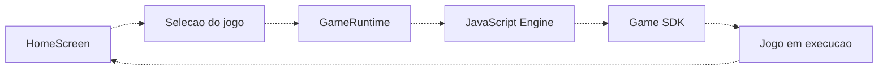

# Micro Console

Firmware para um console baseado em ESP32 DevKit (`esp32dev`), desenvolvido com PlatformIO e Arduino. O projeto está em desenvolvimento: atualmente inclui inicialização do console, configuração via LittleFS, HALs de input, display e Storage, leitor de pacotes de jogos, descoberta de jogos no cartão e o menu principal navegável.

## Recursos atuais

- Inicialização coordenada por `Boot`, com validação de conflitos entre GPIOs antes de configurar o hardware.
- Configuração do console em `data/config.ini`, carregada do LittleFS.
- Oito botões com `INPUT_PULLUP`, debounce de 25 ms e consulta de estado e bordas.
- Painel ILI9341 240x320 via SPI, com rotação, desenho imediato e brilho por PWM.
- Storage HAL para microSD por SPI, com consultas e leitura de arquivos em blocos; sua falha não bloqueia o console.
- Game Package para validar pacotes `.ali`, ler o manifesto e abrir arquivos internos incrementalmente.
- Game Library para descobrir e representar os jogos válidos em `/games`, sem executá-los.
- Menu principal com as opções Jogos, Configuracoes e Sobre, com seleção circular por UP/DOWN.
- Simulação do circuito no Wokwi.

A tela que consome a Game Library, o áudio e o runtime JavaScript ainda não estão implementados.
O formato `.ali` V1 está descrito em [`docs/game-package-format.md`](./docs/game-package-format.md), e sua decisão arquitetural em [`ADR-0005`](./docs/adr/0005-formato-do-game-package.md). A Game Library está documentada em [`docs/game-library.md`](./docs/game-library.md).
O módulo `System` oferece consultas pontuais de uptime e heap livre; detalhes em [`docs/system.md`](./docs/system.md).

## Arquitetura

O firmware é organizado em camadas. `Console` é o composition root: possui e conecta os componentes, enquanto `Boot` coordena a inicialização. Os HALs abstraem o hardware; `GameLibrary` descobre pacotes `.ali` por meio do `Storage`. A tela inicial ainda não consome a biblioteca de jogos.

### Visão geral



As setas sólidas representam relações implementadas; as tracejadas indicam partes planejadas. A `GameLibrary` é preenchida no boot quando o cartão monta, mas a opção Jogos do menu ainda não abre nem exibe essa lista.

### Responsabilidades

| Componente | Responsabilidade | Estado |
|---|---|---|
| `Console` | Compõe os componentes e coordena o ciclo de atualização. | Implementado |
| `Boot` | Carrega a configuração, valida declarações de pinos e inicializa os módulos. | Implementado |
| `Config` | Carrega e fornece as configurações persistentes do console. | Implementado |
| `HomeScreen` | Exibe o menu e permite navegar entre as opções. | Implementado |
| HAL (`Display`, `Input`, `Storage`) | Abstrai o acesso ao display, aos controles e ao cartão microSD. | Implementado |
| `GameLibrary` | Descobre pacotes válidos em `/games` e mantém seus metadados. | Implementado |
| `GamePackage` | Lê e valida o formato de pacote `.ali`. | Implementado |
| `System` | Consulta uptime e heap livre da plataforma. | Implementado |
| `GameRuntime` | Gerencia o ciclo de vida e a execução dos jogos. | Planejado |
| JavaScript Engine | Interpreta o código JavaScript dos jogos. | Planejado |
| Game SDK | Oferece aos jogos uma API para usar os recursos do console. | Planejado |

### Fluxo atual e fluxo planejado

No firmware atual, o boot inicializa os módulos; depois, o `Console` tenta descobrir os jogos se o `Storage` estiver montado. No loop, o input é atualizado antes da tela inicial:



O fluxo futuro prevê seleção e execução de um jogo; essas etapas ainda não estão implementadas:



### Estrutura de um pacote `.ali`

Um `.ali` é um container binário sequencial, não um diretório compactado. O índice referencia os arquivos internos; `manifest.json` descreve o jogo, seu entrypoint e sua capa.

```text
MeuJogo.ali
├── Cabecalho (ALIP, versao e tamanho do indice)
├── Indice (caminhos, offsets e tamanhos)
├── manifest.json
└── Conteudos indexados
    ├── Codes/main.js
    ├── Assets/...
    └── Capa.bin
```

O formato e a validação já estão implementados. A leitura fornece os arquivos em blocos; a execução do entrypoint JavaScript continua planejada.

## Hardware padrão

| Componente | Sinal | GPIO |
|---|---|---:|
| Botões | A / B / X / Y | 13 / 14 / 16 / 17 |
| Direcional | UP / DOWN / LEFT / RIGHT | 18 / 19 / 21 / 22 |
| Display ILI9341 | SCK / MOSI / CS / DC | 4 / 23 / 27 / 32 |
| Display ILI9341 | LED (backlight) | 33 |
| Display ILI9341 | MISO / RST | desligados (`-1`) |
| microSD (SPI dedicado) | SCK / MISO / MOSI / CS | 5 / 35 / 2 / 15 |

Os botões são ligados entre o GPIO e GND; o firmware usa `INPUT_PULLUP`, então nível LOW significa pressionado. A entrada deve ser compatível com 3,3 V. O circuito do simulador e as conexões estão em [`diagram.json`](./diagram.json).

## Requisitos

- ESP32 DevKit com flash de 4 MB, ou o simulador Wokwi.
- PlatformIO Core e os pacotes da plataforma ESP32. No ambiente VS Code deste projeto, o executável está em `~/.platformio/penv/bin/pio`.
- Para gerar a imagem de simulação, também são necessários `esptool` e a instalação de pacotes PlatformIO usada pelo script.

## Compilar e gravar

Na raiz do repositório:

```bash
# Compilar
~/.platformio/penv/bin/pio run

# Gravar o firmware (detecta a porta serial)
~/.platformio/penv/bin/pio run -t upload

# Gravar data/ no LittleFS
~/.platformio/penv/bin/pio run -t uploadfs

# Monitor serial
~/.platformio/penv/bin/pio device monitor
```

O monitor serial usa 115200 baud. Grave o filesystem após alterar `data/config.ini`; a configuração é montada em `/config.ini` no dispositivo. Caso o arquivo não exista, o firmware informa o ocorrido e usa os valores padrão definidos nos módulos.

## Simular no Wokwi

O Wokwi usa a imagem completa da flash indicada em [`wokwi.toml`](./wokwi.toml), incluindo o firmware e o LittleFS. Gere ou atualize essa imagem depois de alterar o firmware ou `data/`:

```bash
./build.sh
```

O script compila o firmware e o filesystem e combina as imagens em `.pio/build/esp32/merged.bin`. Inicie então a simulação pelo Wokwi. A imagem combinada não é atualizada automaticamente.

## Configuração

Os valores de `data/config.ini` são pares `chave=valor`. Pinos, rotação e brilho podem ser alterados sem recompilar o firmware:

| Chave | Padrão | Descrição |
|---|---:|---|
| `input.a`, `input.b`, `input.x`, `input.y` | 13, 14, 16, 17 | GPIOs dos botões de ação |
| `input.up`, `input.down`, `input.left`, `input.right` | 18, 19, 21, 22 | GPIOs do direcional |
| `display.sck` | 4 | Clock SPI |
| `display.mosi` | 23 | Dados SPI para o display |
| `display.cs` | 27 | Chip select |
| `display.dc` | 32 | Data/command |
| `display.led` | 33 | Backlight; `-1` deixa o backlight sem controle por GPIO |
| `display.miso`, `display.rst` | `-1` | MISO e reset, não usados por padrão |
| `display.rotation` | 0 | Rotação de 0 a 3 |
| `display.brightness` | 255 | Brilho PWM de 0 a 255 |
| `storage.sck` | 5 | Clock SPI do cartão microSD |
| `storage.miso` | 35 | Dados do cartão para o ESP32 |
| `storage.mosi` | 2 | Dados do ESP32 para o cartão |
| `storage.cs` | 15 | Chip select do cartão |
| `storage.frequency` | 20000000 | Frequência SPI em Hz (400 kHz a 40 MHz) |

Os pinos do display devem ser válidos para o ESP32 e não podem se repetir entre si. GPIOs 6–11 são reservados para a flash. GPIOs 34–39 são somente entrada e não servem para sinais de saída do display. Conflitos entre pinos de módulos obrigatórios impedem a inicialização; conflito com o módulo Storage opcional desabilita apenas o Storage.

Os pinos de Storage são defaults configuráveis, não uma pinagem definitiva. Os quatro sinais SPI são obrigatórios; GPIOs 2, 5 e 15 são pinos de strapping, então confirme que o módulo microSD não afeta os níveis de boot e ajuste `data/config.ini` conforme a placa. O Storage usa um barramento VSPI dedicado, diferente do SPI2_HOST usado pelo Display. Uma falha de montagem ou conflito nos pinos do módulo opcional é reportado, mas não impede Display, Input ou o menu de iniciarem. A montagem SD é síncrona durante o boot e a ausência do cartão pode atrasar a exibição do menu. O Wokwi atual não simula o cartão SD, então a leitura de arquivos precisa de validação física.

## Interfaces disponíveis

O loop principal chama `Console::update()`, que atualiza o input e a tela inicial. A interface pública do console dá acesso ao input, ao display e ao Storage:

```cpp
console.input().isPressed("A");
console.input().wasPressed("A");
console.input().wasReleased("A");

console.display().clear(0x0000); // RGB565
console.display().fillRect(10, 10, 40, 30, 0xFFFF);
console.display().drawText(10, 50, "Ola", 0xFFFF, 1);

if (console.storage().isMounted()) {
    StorageFile file;
    if (console.storage().open("/games/list.txt", file)) {
        uint8_t buffer[64];
        const size_t count = file.read(buffer, sizeof(buffer));
    }

    StorageDirectory directory;
    StorageEntry entry;
    if (console.storage().openDirectory("/games", directory)) {
        while (directory.next(entry)) {
            // entry.name e entry.isDirectory: apenas filhos imediatos
        }
    }
}
```

`StorageFile` fecha automaticamente ao sair de escopo e também pode ser fechado explicitamente; leituras em um arquivo fechado retornam zero. `StorageDirectory` faz o mesmo e ocupa um dos quatro slots de arquivo aberto; `next()` lista apenas filhos imediatos, sem recursão. `StorageFileInfo` contém apenas `isDirectory` e `size`. As consultas `wasPressed()` e `wasReleased()` representam bordas detectadas na atualização corrente; consulte-as após a atualização de input. O console inicia no menu principal: UP e DOWN alternam a opção selecionada de forma circular, e os demais botões ainda não executam ações.

A Game Library é populada no boot quando o cartão monta e fica disponível pelo `Console`:

```cpp
#include "game/library/game_library.hpp"

console.gameLibrary().scan(); // recarrega /games
for (size_t i = 0; i < console.gameLibrary().count(); ++i) {
    const GameInfo* game = console.gameLibrary().get(i);
    // game->name, game->packagePath, game->coverPath, ...
}
```

A lista contém apenas pacotes válidos, na ordem do sistema de arquivos. `/games` é procurado com essa caixa; subdiretórios e arquivos que não terminam em `.ali` são ignorados. `GameInfo` guarda metadados e o caminho da capa dentro do pacote; nenhuma capa ou arquivo permanece aberto após o `scan()`. A opção Jogos do menu ainda não usa essa lista.

O `GamePackage` recebe uma referência ao Storage e é mantido como membro da `GameLibrary`; ele não é usado diretamente pelo menu. Como o objeto mantém o índice completo em memória (~9 KB), qualquer uso direto também deve ter vida longa:

```cpp
#include "game/package/game_package.hpp"

GamePackage package(console.storage()); // mantenha fora de loop() e de scan()

if (package.open("/games/space.ali")) {
    const GameManifest& manifest = package.manifest();
    PackageFile entrypoint;
    if (package.openFile(manifest.entrypoint, entrypoint)) {
        uint8_t buffer[64];
        const size_t count = entrypoint.read(buffer, sizeof(buffer));
    }
}
```

Use `PackageFile` enquanto consumir o conteúdo; a leitura é limitada ao tamanho declarado no índice e pode ser feita em blocos. EOF prematuro devolve os bytes lidos e fecha o arquivo. Um `PackageFile` aberto pode sobreviver a `GamePackage::close()`, mas o Storage precisa continuar vivo até o arquivo ser fechado ou destruído. Cada `PackageFile` ocupa um dos quatro slots de arquivo aberto do Storage, compartilhados com qualquer `StorageFile` ou `StorageDirectory`. O manifesto e o entrypoint são dados, não são executados. O formato, limites, consumo de memória e campos do manifesto estão na [especificação `.ali`](./docs/game-package-format.md).

## Estrutura

```text
firmware/
├── main.cpp
├── boot/       # Orquestra a inicialização
├── config/     # Configuração em memória carregada do LittleFS
├── game/
│   ├── library/  # Descoberta e metadados dos jogos em /games
│   └── package/  # Container .ali, manifesto e arquivos internos
├── console/    # Composição do console
├── ui/
│   └── screens/ # Telas da interface (menu principal)
└── hal/
    ├── core/   # Contratos dos módulos e declarações de pinos
    ├── display/
    ├── input/
    └── storage/ # API independente do backend e implementação Arduino SD
data/
└── config.ini
docs/adr/       # Decisões de arquitetura
docs/game-package-format.md
docs/game-library.md
```

Os includes do firmware são relativos a `firmware/`, por exemplo `#include "hal/input/input.hpp"`.

## Verificação

Não há CI configurada. O build do firmware e os testes nativos são:

```bash
~/.platformio/penv/bin/pio run
bash test/run-game-package-tests.sh
python3 test/make_game_package_fixtures.py /path/to/fixture-output
```

Os testes nativos validam o cabeçalho, os registros do índice, os caminhos e o manifesto do Game Package, além da descoberta, do filtro de extensão, dos pacotes inválidos e do limite da Game Library. O gerador cria pacotes válidos e casos malformados para copiar ao cartão; eles não simulam a integração com o Storage físico. Para validar o cartão, use uma placa ESP32 e cartão FAT funcional com a pinagem definida em `data/config.ini`. Teste cartão ausente, `/games` ausente ou vazio, pacotes gerados, arquivo interno inexistente, leitura incremental do `Assets/large.bin` (16 KiB, maior que o buffer de exemplo) e a listagem de vários jogos. O Wokwi deste projeto não cobre esses testes físicos; sem cartão, a inicialização opcional do Storage deve falhar sem impedir o restante do console.

As matrizes detalhadas de integração física e o status de execução estão em [`docs/game-package-validation.md`](./docs/game-package-validation.md) e [`docs/game-library.md`](./docs/game-library.md).
