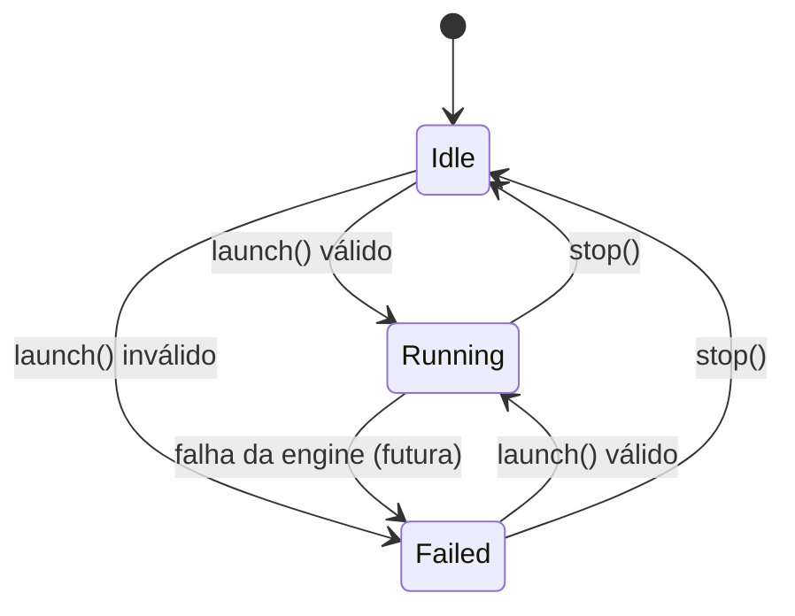
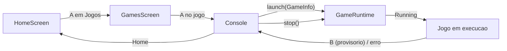

# Game Runtime

O `GameRuntime` controla a execução de **um jogo por vez**: carrega o pacote
indicado pela `GameLibrary`, mantém a sessão ativa, avança o jogo a cada ciclo do
loop cooperativo e encerra liberando os recursos.

```text
Console
   │
   ├── GameLibrary ──► GameInfo
   │                         │
   │                         ▼
   └── GameRuntime ──► GamePackage
            │
            ▼
      JavaScript Engine        (futuro)
            │
            ▼
         Game SDK              (futuro)
```

O Runtime **coordena**; ele não implementa a engine JavaScript nem as APIs do
Game SDK. Nesta versão existe somente o seam de lifecycle: nenhum JavaScript é
interpretado.

Decisões de posse de recursos e de sessão única estão na
[ADR-0006](./adr/0006-game-runtime-session-and-resource-ownership.md).

**Status:** o lifecycle está implementado em `firmware/game/runtime/`, com testes
nativos em `test/game_runtime_test.cpp`. A matriz de validação física continua
pendente.

## Responsabilidade

```text
receber o jogo → abrir e validar o pacote → manter a sessão → atualizar → encerrar
```

Faz parte do Runtime:

- receber a identificação do jogo (`GameInfo`);
- abrir o `.ali` pelo `packagePath` e validá-lo com o `GamePackage`;
- manter o estado público da sessão;
- expor `update()` como único ponto de avanço;
- encerrar e liberar os recursos;
- informar a falha ao chamador por código, sem imprimir.

Não faz parte do Runtime:

- descobrir jogos no cartão → `GameLibrary`;
- interpretar o container `.ali` → `GamePackage`;
- interpretar JavaScript → JavaScript Engine (futura);
- definir as APIs do jogo → Game SDK (futuro);
- desenhar a Home, a lista de jogos ou o aviso de execução → `Console`/UI;
- ler GPIO, operar SPI ou desenhar no Painel → `Input`/`Display`;
- guardar configuração → `Config`;
- oferecer serviços de plataforma → `System`;
- manter mais de uma sessão, fila, retomada ou troca de jogo → inexistente na V1.

## Um jogo por vez

```text
nenhum jogo   →  HomeScreen / GamesScreen
um jogo       →  GameRuntime
```

Não existem `GameRuntimeManager`, `GameSessionManager` ou `GameInstance`. O
`Console` possui uma única instância, como membro de vida longa.

Durante `Running`, o Runtime tem **posse exclusiva** do `Input` e do `Display`:
o `Console` não atualiza nem desenha telas enquanto o jogo está em execução. Isso
evita que navegação de menu consuma as bordas de botão destinadas ao jogo.

## Lifecycle



Estados públicos:

| Estado | Significado |
|---|---|
| `Idle` | Nenhum jogo carregado. Nenhum recurso retido. |
| `Running` | Pacote aberto e válido; `update()` avança a sessão. |
| `Failed` | A última tentativa de `launch()` falhou ou a sessão falhou. Nenhum recurso retido. |

`Failed` é sempre **um estado sem recursos**: o pacote já está fechado e nenhum
arquivo permanece aberto. Por isso o `Console` pode voltar para a Home a partir
de `Failed` sem limpeza adicional.

### `Loading` não é um estado público

`launch()` é síncrono: abre o pacote, lê o índice e o manifesto e valida as
referências antes de retornar. Um estado `Loading` nunca seria observável por um
chamador. Carga assíncrona só deve ser considerada quando a engine existir e
houver uma necessidade concreta; nesse caso ela traz um estado e um contrato
próprios.

## API pública

```cpp
class GameRuntime {
public:
    enum class State : uint8_t { Idle, Running, Failed };

    enum class Failure : uint8_t {
        None,
        InvalidArgument,
        StorageUnavailable,
        PackageOpenFailed,
    };

    static constexpr size_t MAX_INSTANCE_BYTES = 9600;

    explicit GameRuntime(Storage& storage);

    GameRuntime(const GameRuntime&) = delete;
    GameRuntime& operator=(const GameRuntime&) = delete;

    bool launch(const GameInfo& game);
    void update();
    void stop();

    State state() const;
    Failure failure() const;
    bool isRunning() const;       // state() == State::Running
    uint32_t frameCount() const;  // atualizações desde o último launch bem-sucedido

private:
    Storage& storage_;
    GamePackage package_;
    State state_;
    Failure failure_;
    uint32_t frameCount_;
};
```

`State` e `Failure` são enums aninhados em `GameRuntime` para não poluir o
namespace global do firmware; no `Console`, use
`GameRuntime::State::Failed` e `GameRuntime::Failure::PackageOpenFailed`.

O Runtime depende apenas de `Storage` e `GamePackage`. `Input`, `Display` e
`System` só devem entrar quando houver uma responsabilidade real que os use.

O código fica em `firmware/game/runtime/`. O `GameRuntime` **não** é um HAL: não
implementa `hal_module` nem `hal_updatable` e não possui `begin()`; a sessão só
existe depois de um `launch()`.

O limite de memória é verificado por `static_assert`, como em `GamePackage` e
`GameLibrary`.

## `launch()`

```cpp
bool launch(const GameInfo& game);
```

O Runtime aceita `GameInfo` porque esse é o tipo que a `GameLibrary` produz e que
a `GamesScreen` tem em mãos. Ele usa **somente `game.packagePath`** e não copia
nem retém o `GameInfo`: o manifesto dentro do pacote é a fonte da verdade e
`GameInfo` é derivado dele.

Ordem de avaliação e resultado:

| Situação | Retorno | Estado final |
|---|---|---|
| já está em `Running` | `false` | inalterado, jogo atual preservado |
| `packagePath` nulo ou vazio | `false` | `Failed`, `Failure::InvalidArgument` |
| Storage não montado | `false` | `Failed`, `Failure::StorageUnavailable` |
| `GamePackage::open()` falha | `false` | `Failed`, `Failure::PackageOpenFailed` |
| sucesso | `true` | `Running`, `Failure::None`, `frameCount() == 0` |

A checagem de sessão ativa vem primeiro: uma chamada rejeitada não tem efeito
algum, nem mesmo sobre `failure()`.

Regras:

- **Lançar com jogo em execução é rejeitado, não substituído.** O Runtime não
  chama `stop()` internamente; a chamada é um no-op e `failure()` não muda. O
  chamador distingue a rejeição por `isRunning()`.
- `Failed` pode ser substituído por um `launch()` bem-sucedido; não é preciso
  chamar `stop()` antes.
- A validação da V1 termina em `GamePackage::open()`: cabeçalho, índice,
  manifesto, entrypoint e capa indexados. O Runtime **não** abre o entrypoint
  para provar legibilidade, porque `PackageFile` descarta bytes sequencialmente
  até o offset e esse custo será pago pela engine. "Válido para o Runtime" é
  equivalente a "válido para o `GamePackage`" nesta versão.
- Nenhum arquivo permanece aberto depois que `launch()` retorna.

## `update()`

```cpp
void update();
```

- `state() != Running` → retorno imediato, sem efeito. Chamar `update()` em
  `Idle` ou `Failed` é sempre seguro.
- `Running` → incrementa `frameCount()` e, quando a engine existir, será o
  **único** ponto de avanço do jogo:

```text
update()
   ├── engine.update()      (futuro)
   └── frameCount_++
```

- Uma falha da engine no futuro deve levar a `Failed` e fechar o pacote na mesma
  chamada, preservando `frameCount()` para diagnóstico. `Failed` continua
  significando "nada retido".
- Não lê `Input`, não desenha e não calcula delta time nesta versão.

`frameCount()` é o efeito observável mínimo de `update()` sem engine. Ele existe
para validar lifecycle em hardware e em teste nativo; não é gameplay.

## `stop()`

Idempotente. Ordem:

```text
package_.close()
   → frameCount_ = 0
      → failure_ = None
         → state_ = Idle
```

`stop()` não desenha, não notifica telas e não conhece o `Console`. A transição
Home → jogo → Home é responsabilidade do `Console`. Em `Failed`, `stop()` apenas
limpa o diagnóstico, pois o pacote já está fechado.

## Integração com Console e GamesScreen



- `GamesScreen` **não** inicia jogos. Ela expõe a seleção por
  `const GameInfo* selected() const` e deixa de tratar `A`/`B`; `update()` fica
  somente com navegação e desenho. Essa mudança entra junto com a implementação
  do Runtime: hoje `A` e `B` apenas fecham a lista.
- O `Console` decide iniciar, encerrar e para onde voltar. Assim a UI não
  depende do Runtime e o Runtime não depende da UI.
- Modo exclusivo, ordem das decisões em `Console::update()`:

```text
Input::update()

se GameRuntime::isRunning():
    GameRuntime::update()
    se B: stop() e HomeScreen::begin()
    retornar                       # telas não leem input nem desenham

se state() == Failed:
    logar failure() uma vez
    stop() e HomeScreen::begin()
    retornar

se GamesScreen visível:
    B → fechar e HomeScreen::begin()
    A → selected(); se launch() ok, fechar e mostrar aviso de execução
    caso contrário → GamesScreen::update()
    retornar

HomeScreen::update()
```

Voltar para a Home significa chamar `HomeScreen::begin()`, não apenas
`GamesScreen::close()`: `HomeScreen::update()` só redesenha quando a seleção
muda, então a lista ficaria congelada na tela.

- O `Runtime` **não imprime**. Ele devolve `Failure`; o `Console` traduz para o
  Serial. Isso mantém `game/runtime/` compilável em teste nativo sem depender de
  `Arduino.h`.
- Enquanto não existe engine, `Console` exibe um aviso simples ao entrar em
  `Running` ("JOGO EM EXECUCAO" / "B: SAIR") para não deixar a lista de jogos
  congelada na tela. Não é uma nova tela nem um novo estado de UI.
- **`B` como saída da V1 é provisório.** Quando existir engine/SDK, o botão
  pertence ao jogo e a saída migra para o menu do sistema. O `Console` deve
  marcar isso como política temporária, não como contrato.

## Relação com GameLibrary e GamePackage

O Runtime não recebe propriedade do pacote da biblioteca e não altera a lista:

```text
GameLibrary
    └── GamePackage   → usado somente durante scan()

GameRuntime
    └── GamePackage   → usado somente durante a sessão
```

Cada instância guarda índice e manifesto próprios. A cópia é deliberada: evita
expor `GamePackage&` interno da biblioteca e evita transferência de propriedade
no meio do lifecycle.

O caminho do jogo vem de `GameInfo::packagePath`; o Runtime não procura jogos,
não valida `/games` e não chama `scan()`. Se o pacote mudar no cartão entre a
descoberta e o `launch()`, a validação do `GamePackage` decide o resultado.

## JavaScript Engine (futuro)

A engine será uma dependência interna do Runtime, nunca o contrário:

```text
GameRuntime
      │
      ▼
JavaScriptEngine
      │
      ▼
Game SDK
```

Ponto de inserção fechado nesta versão:

```text
launch()   → abre e valida o pacote
update()   → engine.update()
stop()     → engine.stop(); package.close()
```

**Não criar uma interface `GameEngine` agora.** A engine ainda não foi escolhida;
a interface seria inventada sem um consumidor real. O contrato acima já fixa
onde ela entra.

## Fronteira com o Game SDK (futuro)

O jogo não recebe acesso a `Display`, `Input`, `Storage`, `System` nem ao
`Console`:

```text
JavaScript (jogo)
      │
      ▼
Game SDK      → input, graphics, audio, filesystem limitado, utilitários
      │
      ▼
System / HAL
```

O Game SDK pertence à camada de execução, não ao lifecycle. O Runtime não deve
crescer para virar SDK.

## Memória

| Componente | Bytes |
|---|---:|
| `GameLibrary` (inclui `GamePackage` de scan) | ~17.040 |
| `GameRuntime` (inclui `GamePackage` próprio) | ~9.400 |
| Total de gerenciamento de jogos | ~26.400 |

O segundo `GamePackage` custa aproximadamente 9,3 KB permanentes. A decisão e a
alternativa (içar um único `GamePackage` para o `Console` e injetá-lo) estão na
[ADR-0006](./adr/0006-game-runtime-session-and-resource-ownership.md).

`launch()` chama `GamePackage::open()`, que usa ~4,1 KB de stack (buffer de
manifesto). Chamado de dentro de `loop()`, cabe na stack padrão da loopTask, mas
deve ser considerado junto com o custo de `scan()` no boot, que não é simultâneo.

## Erros e diagnóstico

| `Failure` | Causa | Ação do `Console` |
|---|---|---|
| `InvalidArgument` | `packagePath` vazio/nulo | Logar; permanecer na lista |
| `StorageUnavailable` | cartão não montado | Logar; permanecer na lista |
| `PackageOpenFailed` | pacote inválido, manifesto inválido, entrypoint/capa ausente | Logar; permanecer na lista |

`Failure::None` vale em `Idle` e em `Running`; qualquer outro valor acompanha
`Failed`.

Não há exceções, retry automático, timeout, quarentena nem log estruturado nesta
versão. Uma falha de `launch()` não apaga a `GameLibrary` nem sai da
`GamesScreen`.

## Testes nativos

`test/game_runtime_test.cpp` + `test/run-game-runtime-tests.sh`, no padrão do
runner da Game Library: C++11, `-Wall -Wextra -Werror`, ASan/UBSan e o fake de
Storage em memória. O Runtime não inclui `Arduino.h`.

Cobertura mínima:

- estado inicial `Idle`, `!isRunning()`, `failure() == None`;
- `packagePath` vazio → `InvalidArgument`;
- Storage não montado → `StorageUnavailable`;
- pacote inexistente, corrompido ou com manifesto inválido →
  `PackageOpenFailed`;
- `launch()` válido → `Running` e `frameCount() == 0`;
- `update()` em `Idle`/`Failed` sem efeito; em `Running`, incrementa por chamada;
- `launch()` com jogo em execução → `false`, `Running` preservado, frames
  preservados;
- `stop()` → `Idle`, `failure() == None`, frames zerados; segunda chamada
  idempotente;
- `Failed` → `launch()` válido → `Running`;
- dois jogos válidos em sequência sem estado residual do primeiro;
- `storage.openFileCount() == 0` ao final de cada cenário;
- orçamento de memória por `static_assert`.

## Matriz física

**Status: pendente.** Depende do cartão microSD físico, que o Wokwi deste projeto
não simula.

| ID | Cenário | Resultado esperado |
|---|---|---|
| RT-01 | `launch()` de `.ali` válido | Serial confirma; aviso de execução aparece; `frameCount()` cresce |
| RT-02 | `launch()` de arquivo inexistente | Permanece na lista; Serial informa `PackageOpenFailed` |
| RT-03 | `launch()` de pacote corrompido | Permanece na lista; nenhum slot de arquivo vazado |
| RT-04 | Iniciar jogo sem cartão (Storage não montado) | Lista vazia; caminho de `launch()` não é alcançado |
| RT-05 | `B` durante `Running` | `stop()`; Home redesenhada |
| RT-06 | `B` na lista | Volta à Home; `Runtime` continua `Idle` |
| RT-07 | Dois `launch()` consecutivos sem `stop()` | Segundo é rejeitado; primeiro continua |
| RT-08 | Jogo válido, `stop()`, mesmo jogo de novo | Segunda sessão inicia com `frameCount()` zerado |
| RT-09 | Medir heap antes/depois de `launch()`/`stop()` | Sem queda permanente; dois `GamePackage` residentes |
| RT-10 | Cycling de 20 `launch()`/`stop()` | Sem vazamento de slots nem fragmentação perceptível |

## Limitações da V1

- Nenhum JavaScript é executado; `Running` apenas avança `frameCount()`.
- `B` para sair é provisório e pertence ao `Console`.
- Não há pause, retomada, save, áudio, gráficos de jogo, assets ou filesystem do
  jogo.
- Não há carregamento assíncrono, timeout, fila, multitarefa ou FreeRTOS.
- O aviso de execução é um placeholder textual, não uma tela de jogo.
- Uma sessão por vez, sem hot reload e sem troca de jogo em execução.
- Os limites de memória da engine só serão definidos com a engine escolhida; não
  invente `MAX_SCRIPT_SIZE` ou similares antes disso.
